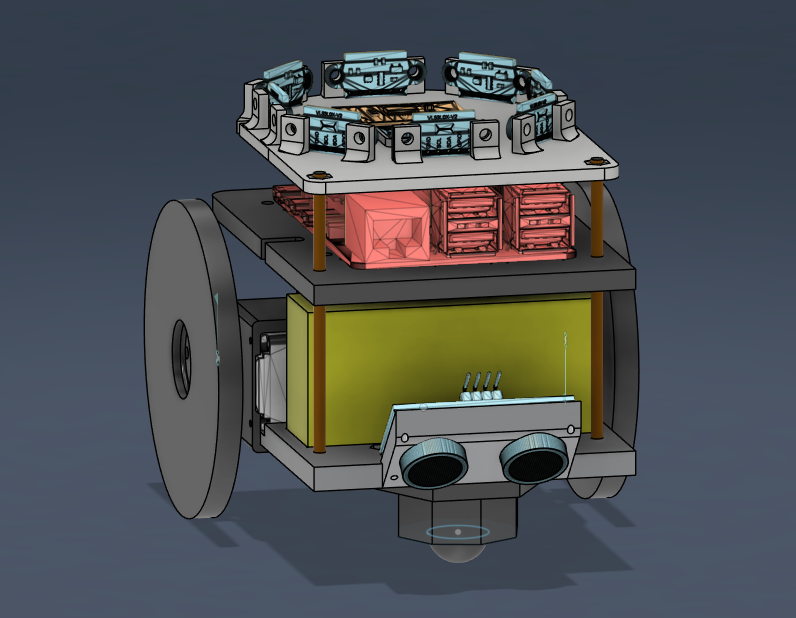

# ARMADA

**A**utonomous **R**obots for **M**ulti**A**gent **D**istributed **A**rchitecture

A small, low-cost differential-drive robot built around an ESP32, cheap enough to build in numbers for multi-robot
experiments. You drive it from your phone through a web page served by the robot itself, and the code is structured
to be plugged into ROS / micro-ROS later.



## What's on the robot

- 2 wheels driven by Feetech STS3215 smart servos (12 V), plus a free caster
- 8 VL53L0X time-of-flight sensors in a ring (a cheap "lidar"), read through an I²C multiplexer
- 1 HC-SR04 ultrasonic sensor pointing at the floor (cliff detection)
- ESP32 controller: creates its own Wi-Fi network and serves a joystick page with live distances
- Safety: motors stop if the controller stops sending commands
- Odometry from the servo encoders, ready for ROS

## Status

Under active development. The wheels and the ToF ring work. The web page, floor sensor, safety timeout and
odometry are written but not yet tested on the robot. micro-ROS is a test sketch only; a BNO055 IMU is planned.

## Get started

1. **[Hardware guide](docs/HARDWARE.md)**: parts and wiring.
2. **[Software guide](docs/SOFTWARE.md)**: flash the ESP32 and drive the robot.
3. *(Optional)* **[Theory](docs/THEORY.md)**: how the robot works, in short.

Once it is built and flashed, join the `ARMADA-XXXX` Wi-Fi network and open `http://192.168.4.1`.

## Repository

```
Armada_robot/armada_esp/   firmware (open armada_esp.ino in the Arduino IDE)
Armada_robot/armada_esp_micro_ros/  same robot driven by ROS 2 (micro-ROS) instead of the web page
armada_description/        URDF + meshes
armada_ros/                ROS 2 interface on the PC, identical for the real and the simulated robot
armada_simulation/         Gazebo multi-robot simulation
tests/                     standalone hardware test sketches
docs/                      guides
images/                    CAD pictures and wiring diagram
```

## License

GPL-3.0, see [LICENSE](LICENSE).
