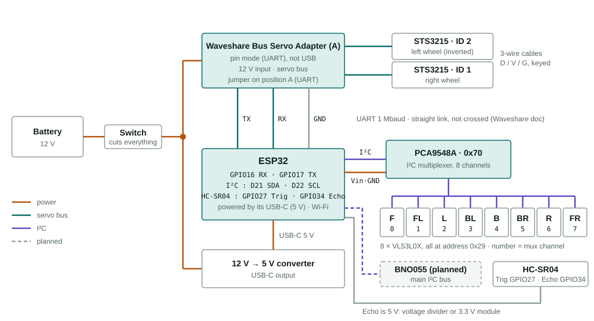
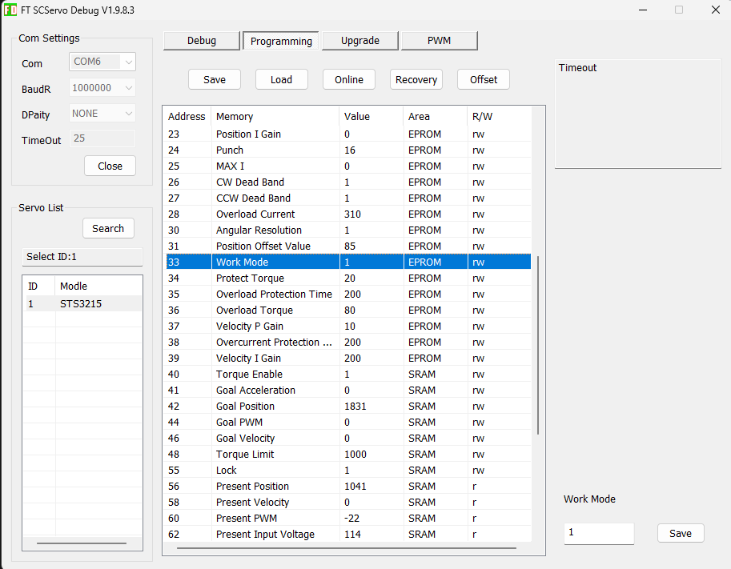
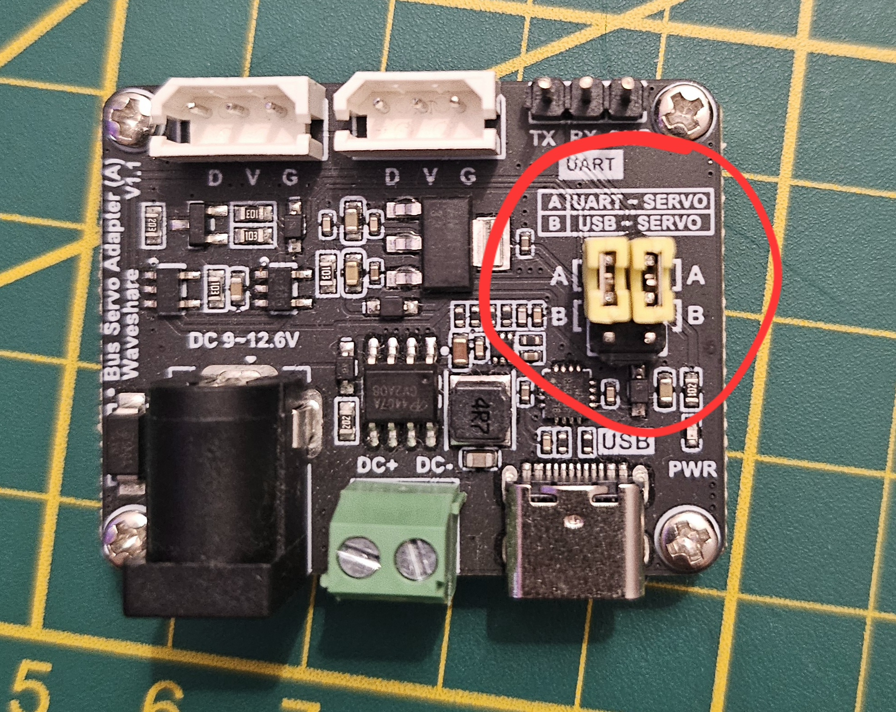
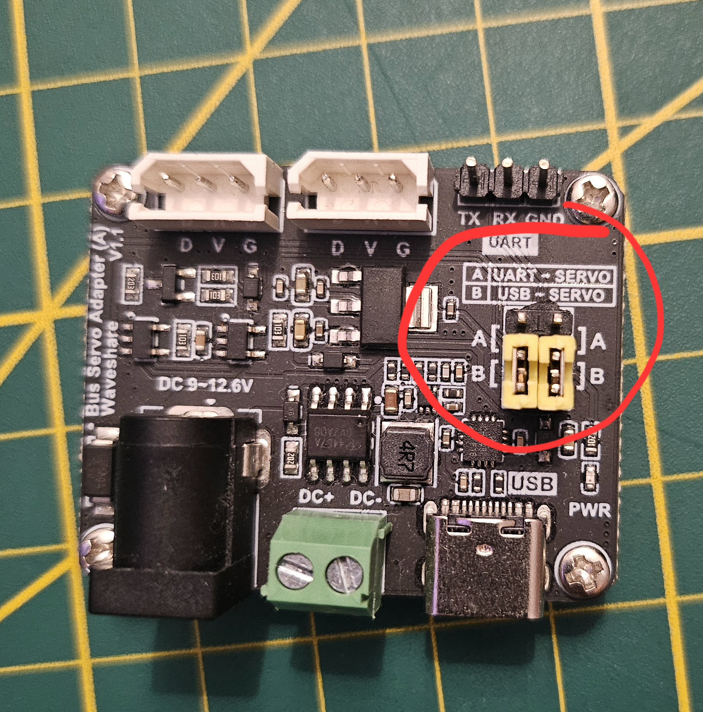

# Hardware guide

How to wire an ARMADA robot. Then flash it with the [software guide](SOFTWARE.md).

> Wire everything with the battery **switched OFF**, and check polarity before powering on.

## Parts

| Part                                    | Qty | Notes                                         |
| --------------------------------------- | --- | --------------------------------------------- |
| ESP32 dev board (WROOM)                 | 1   | On a WROVER, GPIO16/17 are taken by the PSRAM |
| Feetech STS3215 servo, **12 V version** | 2   | The 7.4 V version dies on 12 V                |
| Waveshare _Bus Servo Adapter (A)_       | 1   | UART mode                                     |
| 12 V battery + main switch              | 1   | Switch right after the battery                |
| 12 V → 5 V converter with USB-C output  | 1   | Plugs into the ESP32 USB-C                    |
| PCA9548A I²C multiplexer                | 1   | Address 0x70                                  |
| VL53L0X breakout                        | 8   |                                               |
| HC-SR04 ultrasonic sensor               | 1   |                                               |

## Pins

| ESP32    | Goes to                      |
| -------- | ---------------------------- |
| GPIO16   | Servo driver RX              |
| GPIO17   | Servo driver TX              |
| GPIO21   | Multiplexer SDA              |
| GPIO22   | Multiplexer SCL              |
| GPIO27   | HC-SR04 Trig                 |
| GPIO34   | HC-SR04 Echo                 |
| 5V / VIN | Multiplexer Vin, HC-SR04 VCC |
| GND      | Everything (common ground)   |

Pins are `#define`d at the top of `Armada_robot/armada_esp/armada_esp.ino`.

## 1. Power

Battery → switch → 12 V rail. The rail feeds the **servo driver** (12 V input) and the **12→5 V converter**, whose
USB-C goes into the **ESP32**. Join a GND of the driver to a GND of the ESP32.

> Never have the battery on **and** a computer plugged into the ESP32 USB. Switch the robot OFF to flash it.

## 2. Servos

1. Servos ship with ID 1. Give them different IDs **before assembly** (Waveshare/Feetech servo tool, one servo on the
   bus at a time): **ID 1 = right wheel, ID 2 = left wheel**.

   **IMPORTANT :** In order to use these servos as a wheel, the WORK_MODE variable has to be set at 1 in the motor's EEPROM.

   I used the FT SCServo software :

   

2. Plug both servos into the driver (keyed 3-wire cables).
3. Set the driver **jumpers** (the two yellow caps next to the `A` / `B` marking) according to what you are doing:

   | Position | Marking on the board | Use it to                                                                                                                                 |
   | -------- | -------------------- | ----------------------------------------------------------------------------------------------------------------------------------------- |
   | **A**    | `UART ↔ SERVO`       | **Run the robot**: the ESP32 talks to the servos through the TX / RX / GND pins (no USB).                                                 |
   | **B**    | `USB ↔ SERVO`        | **Configure the servos from a PC**: plug the driver's USB-C into your computer and use the FT SCServo software (set IDs, WORK_MODE, ...). |

   | Jumper on **A** (robot)                                                            | Jumper on **B** (PC configuration)                                                 |
   | ---------------------------------------------------------------------------------- | ---------------------------------------------------------------------------------- |
   |  |  |

   Both caps must be on the same letter. Use **B** for step 1 above, then move them back to **A** before connecting the
   ESP32. Power the driver with the 12 V supply in both cases.

4. Wire driver ↔ ESP32 **straight, not crossed**: RX–GPIO16(RX), TX–GPIO17(RX), GND–GND.

## 3. ToF ring

ESP32 → multiplexer: SDA = GPIO21, SCL = GPIO22, Vin, GND. Each VL53L0X goes on its own multiplexer channel
(SDx / SCx + Vin + GND). Channels run **counter-clockwise from the front, every 45°**:

| Channel   | 0     | 1    | 2    | 3     | 4    | 5     | 6     | 7    |
| --------- | ----- | ---- | ---- | ----- | ---- | ----- | ----- | ---- |
| Name      | F     | FL   | L    | BL    | B    | BR    | R     | FR   |
| Direction | front | +45° | left | +135° | back | −135° | right | −45° |

## 4. Floor sensor

Mount the HC-SR04 at the front, tilted toward the floor (the web page expects about **5 cm** to the ground).
VCC → 5 V, GND → GND, Trig → GPIO27, and Echo → GPIO34

## Before the first power-on

- [ ] No short between 12 V and GND
- [ ] Driver jumpers back on **A** (UART), servo IDs and WORK_MODE set
- [ ] Wheels lifted off the table
